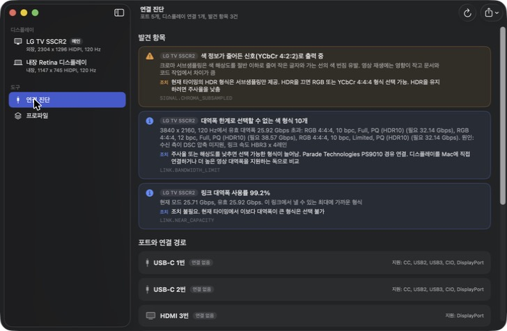
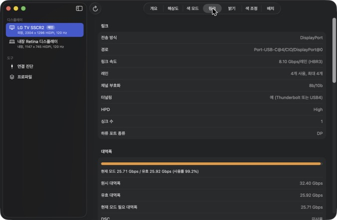

<div align="center">

# `TheBestDisplay`

**macOS 디스플레이 설정과 연결 진단을 한 창에 모은 앱**

해상도, HiDPI, 주사율, HDR, 색 모드(RGB, YCbCr), DSC 상태를 조회하고 바꾸며, 화면이 나오지 않거나 원하는 모드를 고를 수 없는 이유를 수치로 표시


```bash
scripts/build_app.sh && open build/TheBestDisplay.app
```



</div>

---

앱을 열면 왼쪽에 연결된 디스플레이 목록이, 오른쪽에 선택한 디스플레이의 탭 7종(개요, 해상도, 색 모드, 링크, 밝기, 색 조정, 배치)이 표시됨.
색 모드 탭에서 현재 송출 중인 신호 형식을 확인하고 다른 형식으로 전환 가능.
연결 진단 화면은 포트마다 케이블, 독, 영상 링크, 디스플레이까지의 경로와 점검 6단계를 표시하고, 선택할 수 없는 색 형식에는 필요 대역폭과 유효 대역폭을 함께 표시.
화면이 바뀌는 변경은 모두 확인 대화상자를 거치며, 15초 안에 유지를 누르지 않으면 이전 설정으로 복귀.
같은 기능을 명령행 도구 `tbdctl`로도 사용 가능.

---

## 목차

1. [개요](#1-개요)
   - [기능](#기능)
   - [동작 구조](#동작-구조)
2. [설치](#2-설치)
   - [소스 빌드](#소스-빌드)
   - [요구 사항](#요구-사항)
3. [빠른 시작](#3-빠른-시작)
4. [사용법](#4-사용법)
   - [창 앱](#창-앱)
   - [명령행 도구](#명령행-도구)
   - [자동 복귀 안전장치](#자동-복귀-안전장치)
   - [단축키](#단축키)
5. [설정 파일](#5-설정-파일)
6. [지원 범위](#6-지원-범위)
   - [검증 구성](#검증-구성)
   - [제약](#제약)
7. [개발](#7-개발)
   - [저장소 구성](#저장소-구성)
   - [테스트](#테스트)
   - [명세 문서](#명세-문서)
8. [로드맵](#8-로드맵)
9. [라이선스](#9-라이선스)

---

## 1. 개요

### 기능

| 영역 | 내용 |
| --- | --- |
| 디스플레이 정보 | 제품 정보, 물리 크기, EDID 해석(기본 블록, CTA-861, DisplayID), 싱크 능력 요약, EDID 원본 저장 |
| EDID 오버라이드 | EDID 검증, 편집(DSC, HDR, YCbCr, 4:2:0, VRR 선언 제거, FRL과 TMDS 상한), 사용자 정의 타이밍 추가(CVT-RB, CVT-RB2, 직접 지정), 가상 EDID 적용과 해제, 디스플레이 재감지 |
| 해상도와 주사율 | 숨은 모드를 포함한 전체 모드 열거, 필터, 전환, 시스템 설정 목록 밖 모드 표시, 사용자 정의 스케일 해상도 등록, 주사율 측정, 즐겨찾기 모드, 해상도 슬라이더, 렌더링 한계 표시 |
| 색 모드 | 현재 송출 신호(픽셀 인코딩, 비트 심도, 레인지, EOTF, 색 공간) 표시, 현재 타이밍에서 선택 가능한 색 모드 전환, 연결 수준 타이밍 직접 선택 |
| DSC | 소스와 싱크의 지원 여부, 현재 사용 여부, 모드별 DSC 필요 여부 표시. DSC 사용 색 모드와 미사용 색 모드 간 전환으로 켜기와 끄기 |
| HDR | 지원 여부, 켜기와 끄기, 지원 EOTF, EDR 헤드룸 |
| 링크 | 링크 속도, 레인 수, 터널링, 대역폭 사용률, 색 형식별 필요 대역폭, DPCD(다운스프레드, HDCP 능력 포함), 링크 훈련 결과 |
| 포트와 케이블 | 포트별 지원 전송, 플러그 방향, PHY 레인, 케이블 e-marker(속도, 전류, 전압), 독, 연결 경로, 전원 어댑터 |
| 진단 | 포트별 화면 출력 점검 6단계, 발견 항목(근거와 조치), 이벤트 기록, 진단 보고서 내보내기 |
| 밝기와 DDC | 시스템 밝기, DDC 밝기, 소프트웨어 디밍, 자동 밝기, 밝기 동기화, XDR 밝기 업스케일, DDC 대비와 볼륨과 입력과 전원, 임의 VCP |
| 색 조정 | 디스플레이 프리셋(기준 모드), 색 프로파일, 감마, 대비, 색온도, 채널 게인, Night Shift, True Tone |
| 배치 | 회전, 미러, 메인 지정, 위치 편집, 논리적 연결 해제와 재연결, 언더스캔 |
| 가상 디스플레이 | 가상 디스플레이 생성과 삭제, HiDPI 스케일링, 실행 시 복원 |
| 프로파일 | 디스플레이 구성 저장, 적용, 이름 변경, 삭제, 구성 보호(프로파일에서 벗어나면 다시 적용) |

### 동작 구조

| 계층 | 타깃 | 역할 |
| --- | --- | --- |
| 순수 로직 | `TBDCore` | 모델, EDID 해석, 대역폭 계산, 진단 규칙, 자동 복귀 상태 기계, 프로파일 계획. 시스템 호출 없음 |
| 시스템 연동 | `TBDPlatform` | CoreGraphics, IOKit, SkyLight, IOMobileFramebuffer, MonitorPanel, DisplayServices, CoreBrightness 호출 |
| 표시와 입력 | `TheBestDisplay`, `tbdctl` | SwiftUI 창 앱과 명령행 도구 |

- 비공개 프레임워크는 정적 링크하지 않고 실행 시 심볼을 조회. 없는 심볼의 기능은 비활성으로 표시
- 모드, HDR, 회전 전환은 시스템 설정과 같은 MonitorPanel 경로 사용

<p align="right"><a href="#목차">↑ 목차로</a></p>

## 2. 설치

### 소스 빌드

```bash
scripts/build_app.sh
```

- 결과물: `build/TheBestDisplay.app` (ad-hoc 서명). 번들의 `Contents/MacOS/tbdctl`에 명령행 도구 포함
- 명령행 도구만 빌드: `swift build -c release --product tbdctl`
- 배포판과 패키지 관리자 설치는 미제공

### 요구 사항

| 항목 | 값 |
| --- | --- |
| 기기 | Apple Silicon Mac |
| macOS | 15 이상 (검증은 macOS 26.5에서 수행) |
| 빌드 도구 | Xcode의 Swift 6 도구 모음 |
| 외부 패키지 | 없음 |

<p align="right"><a href="#목차">↑ 목차로</a></p>

## 3. 빠른 시작

```bash
scripts/build_app.sh && open build/TheBestDisplay.app
```

- (1) 사이드바에서 디스플레이 선택
- (2) 색 모드 탭에서 현재 송출 신호 확인. 글자가 번져 보이면 YCbCr 4:2:2 또는 4:2:0 출력 여부 확인
- (3) 사이드바의 연결 진단에서 발견 항목의 근거와 조치 확인
- (4) 형식을 바꾸면 확인 대화상자 표시. 화면이 정상이면 유지 선택

명령행에서 같은 정보 확인:

```bash
build/TheBestDisplay.app/Contents/MacOS/tbdctl diagnose
```

<p align="right"><a href="#목차">↑ 목차로</a></p>

## 4. 사용법

### 창 앱

| 화면 | 내용 |
| --- | --- |
| 개요 | 제품 정보, 현재 상태, 싱크 능력, EDID 해석과 원본, EDID 오버라이드(외장) |
| 해상도 | 전체 모드 목록과 필터, 주사율 버튼으로 전환, 즐겨찾기, 해상도 슬라이더, 렌더링 한계, HiDPI 스케일링, 사용자 정의 스케일 해상도 |
| 색 모드 | HDR 전환, 현재 송출 신호, DSC 상태, 색 모드 목록과 적용, 싱크 타이밍 |
| 링크 | 링크 속도와 레인, 대역폭 사용률, 색 형식별 필요 대역폭, DPCD |
| 밝기 | 밝기, 자동 밝기, 밝기 동기화, XDR 밝기 업스케일, DDC 기능 |
| 색 조정 | 디스플레이 프리셋, 색 프로파일, 소프트웨어 조정, Night Shift, True Tone |
| 배치 | 위치 편집, 회전, 메인 지정, 미러, 연결 해제 |
| 연결 진단 | 발견 항목, 포트와 연결 경로, 이벤트 기록, 보고서 내보내기 |
| 가상 디스플레이 | 가상 디스플레이 추가, 켜기와 끄기, 삭제 |
| 프로파일 | 현재 구성 저장, 적용, 이름 변경, 삭제, 구성 보호 |



### 명령행 도구

| 명령 | 내용 |
| --- | --- |
| `tbdctl list` | 디스플레이 목록 |
| `tbdctl capabilities` | 기능별 가용성과 누락 심볼 |
| `tbdctl info <디스플레이> [--edid-out <경로>] [--hex]` | 제품 정보, 싱크 능력, EDID 해석 |
| `tbdctl modes <디스플레이> [--hidpi] [--outside-default]` | 전체 모드 목록 |
| `tbdctl set-mode <디스플레이> <모드> [--timeout <초>] [--yes] [--method <경로>]` | 모드 전환 |
| `tbdctl scaled <디스플레이> [list \| add <폭>x<높이> \| remove <폭>x<높이>]` | 사용자 정의 스케일 해상도 조회, 추가, 삭제 |
| `tbdctl refresh <디스플레이> [--seconds <초>]` | 주사율 측정 |
| `tbdctl favorites <디스플레이> [list \| add [<모드>] \| remove [<모드>]]` | 즐겨찾기 모드 조회, 추가, 삭제 |
| `tbdctl signal <디스플레이> [--timings]` | 현재 송출 신호, 색 모드 목록, DSC 판정 |
| `tbdctl set-color <디스플레이> <색 모드> [--timeout <초>] [--yes]` | 색 모드 전환 |
| `tbdctl set-timing <디스플레이> <타이밍> [--timeout <초>] [--yes]` | 연결 수준 타이밍 직접 선택 (`id:<번호>` 또는 `<폭>x<높이>@<주사율>`) |
| `tbdctl hdr <디스플레이> [on\|off] [--timeout <초>] [--yes]` | HDR 조회와 전환 |
| `tbdctl dsc <디스플레이> [on\|off] [--timeout <초>] [--yes]` | DSC 조회와 전환 |
| `tbdctl edid <디스플레이> check [<파일>]` | EDID 구조 검증과 능력 요약 |
| `tbdctl edid <디스플레이> patch <편집 목록> [--in <파일>] [--out <파일>] [--apply] [--timeout <초>] [--yes]` | EDID 편집, 편집본 저장, 가상 EDID 적용 |
| `tbdctl edid <디스플레이> timing <타이밍> [--preferred] [--in <파일>] [--out <파일>] [--apply] [--timeout <초>] [--yes]` | 사용자 정의 타이밍 계산과 EDID 추가 |
| `tbdctl edid <디스플레이> apply <파일> [--timeout <초>] [--yes]` | EDID 파일을 가상 EDID로 적용 |
| `tbdctl edid <디스플레이> reset` | 가상 EDID 해제 |
| `tbdctl redetect` | 디스플레이 재감지 요청 |
| `tbdctl link <디스플레이>` | 링크 정보, 대역폭, DPCD |
| `tbdctl ports` | 포트, PHY 레인, 케이블, 독, 연결 경로, 전원 어댑터 |
| `tbdctl diagnose` | 포트 점검과 발견 항목 |
| `tbdctl report <경로> [--redact] [--text]` | 진단 보고서 저장 |
| `tbdctl brightness <디스플레이> [0-100]` | 밝기 조회와 설정 |
| `tbdctl xdr <디스플레이> [<배율 %>] [--seconds <초>]` | XDR 밝기 업스케일 조회, 지정 시간 동안 적용 |
| `tbdctl brightness-sync <원본 디스플레이> [--seconds <초>]` | 원본의 밝기를 다른 디스플레이에 동기화 |
| `tbdctl preset <디스플레이> [<번호 또는 이름>] [--timeout <초>] [--yes]` | 디스플레이 프리셋 조회와 전환 |
| `tbdctl ddc <디스플레이> probe \| get <코드> \| set <코드> <값>` | DDC 탐지, VCP 읽기와 쓰기 |
| `tbdctl color <디스플레이> [--profiles]` | 색 프로파일, Night Shift, True Tone 상태 |
| `tbdctl arrangement` | 위치, 회전, 미러 상태 |
| `tbdctl rotate <디스플레이> <각도> [--timeout <초>] [--yes]` | 회전 (0, 90, 180, 270) |
| `tbdctl mirror <디스플레이> <원본\|off> [--timeout <초>] [--yes]` | 미러 설정과 해제 |
| `tbdctl main <디스플레이>`, `move <디스플레이> <x> <y>` | 메인 지정, 위치 지정 |
| `tbdctl disconnect <디스플레이> [--timeout <초>] [--yes]` | 논리적 연결 해제 |
| `tbdctl reconnect [<디스플레이 ID>]` | 연결 해제한 디스플레이 재연결 |
| `tbdctl virtual <폭>x<높이> [--hidpi] [--name <이름>] [--seconds <초>]` | 가상 디스플레이 생성과 유지 |
| `tbdctl profile <list\|show\|save\|apply\|rename\|delete> [<이름>] [<새 이름>] [--replace] [--timeout <초>] [--yes]` | 구성 프로파일 |
| `tbdctl profile check <이름>` | 프로파일과 현재 구성의 차이 조회 |
| `tbdctl profile protect <이름>`, `profile unprotect`, `profile protection` | 구성 보호 설정, 해제, 상태 조회 |
| `tbdctl revert-pending [--discard]` | 확인 없이 종료된 변경의 복귀 |

- 공통 옵션: `--json`
- 디스플레이 지정: 1부터 시작하는 순번, `id:<디스플레이 ID>`, `main`, `builtin`, `external`, 이름 일부
- 모드 형식: `<폭>x<높이>[@<주사율>][:hidpi|:lodpi]` 또는 `mode:<번호>`
- 색 모드 형식: `id:<번호>` 또는 `<rgb|ycbcr444|ycbcr422|ycbcr420>[:<bpc>][:<full|limited>][:<sdr|pq|hlg>]`
- EDID 편집 목록: 쉼표로 이은 `remove-dsc`, `remove-hdr`, `remove-ycbcr`, `remove-420`, `remove-vrr`, `limit-frl:<0-6>`, `limit-tmds:<MHz>`
- 타이밍 형식: `<폭>x<높이>@<주사율>[:rb|:rb2]` (CVT 축소 블랭킹, 기본 rb2) 또는 `raw:<수평 활성>,<프런트 포치>,<동기>,<백 포치>,<수직 활성>,<프런트 포치>,<동기>,<백 포치>,<픽셀 클록 kHz>[,+h|-h][,+v|-v]`
- 종료 코드: 0 성공, 1 실행 실패, 2 사용법 오류, 3 미지원 기능 또는 대상 없음

### 자동 복귀 안전장치

- 대상: 모드, 색 모드, 타이밍 직접 선택, DSC, HDR, 디스플레이 프리셋, EDID 오버라이드, 회전, 미러, 연결 해제, HiDPI 스케일링, 프로파일 적용
- 창 앱: 확인 대화상자에서 15초 안에 유지를 누르지 않으면 이전 설정으로 복귀
- 명령행: Return을 입력하면 확정, 제한 시간(`--timeout`, 기본 15초) 안에 입력이 없으면 복귀. `--yes`는 확인 없이 확정
- 확인 전에 앱이 종료되면 다음 실행 시 복귀 제안 표시. 명령행은 `tbdctl revert-pending`

### 단축키

| 키 | 동작 |
| --- | --- |
| Command + R | 전체 새로 고침 |
| Command + E | 진단 보고서 내보내기 |
| Return | 확인 대화상자의 유지 |
| Escape | 확인 대화상자의 복귀 |

<p align="right"><a href="#목차">↑ 목차로</a></p>

## 5. 설정 파일

위치: `~/Library/Application Support/TheBestDisplay/`

| 파일 | 내용 |
| --- | --- |
| `profiles.json` | 구성 프로파일 |
| `virtual-displays.json` | 가상 디스플레이 구성 |
| `pending-revert.json` | 확인 대기 중인 변경의 복귀 정보. 확정하거나 복귀하면 삭제 |
| `protection.json` | 구성 보호 대상 프로파일과 보호 항목. 보호를 끄면 삭제 |
| `mode-favorites.json` | 디스플레이별 즐겨찾기 모드 |

- 사용자 정의 스케일 해상도는 `/Library/Displays/Contents/Resources/Overrides/` 아래 오버라이드 파일에 저장 (관리자 인증 필요)

- 가상 디스플레이, HiDPI 스케일링, 소프트웨어 디밍, 소프트웨어 색 조정, XDR 밝기 업스케일은 앱 실행 중에만 유지
- 가상 EDID는 재시동 전까지 유지
- 모드, 색 프로파일, HDR, 회전, 배치는 시스템이 저장하므로 앱을 종료해도 유지

<p align="right"><a href="#목차">↑ 목차로</a></p>

## 6. 지원 범위

### 검증 구성

| 항목 | 값 |
| --- | --- |
| 기기 | MacBook Pro (Apple M5), macOS 26.5.2 |
| 외장 디스플레이 | LG TV (3840x2160, 120 Hz, HDR), USB-C 포트의 Thunderbolt 독 경유 |
| 검증 결과 | TC 70건 중 통과 60건, 미실행 7건, 보류 3건 (`docs/TC.md`) |
| 참고 제품 기능 대조 | 58행 중 구현 23행, 부분 22행, 미구현 13행 (`docs/COVERAGE.md`) |

### 제약

| 항목 | 내용 |
| --- | --- |
| Intel Mac | 미지원 |
| Mac App Store 배포 | 불가 (비공개 API 사용, 샌드박스 미적용) |
| DSC 강제 | 시스템이 색 모드로 제공하는 범위 안에서만 켜기와 끄기 가능. DSC 미지원 싱크에서 켜기 같은 강제는 불가 |
| EDID 오버라이드 | 외장 디스플레이 한정. 재시동하면 원본 EDID로 복귀. 디스플레이 저장 장치 쓰기는 미제공. 실제 디스플레이 대상 적용은 미검증 |
| 사용자 정의 타이밍 | 가상 EDID에 상세 타이밍을 추가하는 방식. 시스템과 디스플레이의 수용 여부는 구성에 따라 다름. 실제 디스플레이 대상 적용은 미검증 |
| 내장 디스플레이 회전 | 대상에서 제외 |
| 미검증 구성 | HDMI 직결 링크 정보, DDC 지원 모니터 제어, DSC 사용 모드와 DSC 전환 (장비 없음). 가상 EDID 적용, 사용자 정의 타이밍 적용, 사용자 정의 스케일 해상도 반영 (외장 디스플레이 재연결 필요) |
| 모드 전환 경로 | SkyLight 직접 호출 경로는 독 경유 TV에서 미출력을 유발한 사례가 있어 기본 경로에서 제외 (`docs/adr/0005-mode-switch-path.md`) |

<p align="right"><a href="#목차">↑ 목차로</a></p>

## 7. 개발

### 저장소 구성

| 경로 | 내용 |
| --- | --- |
| `Sources/TBDCore` | 순수 로직 |
| `Sources/TBDPlatform` | 시스템 연동 |
| `Sources/TBDApp` | SwiftUI 창 앱 |
| `Sources/tbdctl` | 명령행 도구 |
| `Tests` | 단위 테스트와 통합 테스트, IORegistry와 EDID 픽스처 |
| `docs` | 명세(MRD, PRD, SRS, TC), ADR, 조사 문서, 로드맵 |
| `scripts` | 앱 번들 조립, 테스트 실행, 추적성 검사 |
| `spikes` | 선행 실험 코드 |

### 테스트

```bash
scripts/test.sh
```

- 통합 테스트는 실제 디스플레이 상태를 읽으며 일부는 밝기, 색 프로파일, Night Shift, True Tone을 바꾼 뒤 복원하고 가상 디스플레이를 잠깐 생성
- 외장 디스플레이가 필요한 테스트는 연결되지 않은 경우 건너뜀
- 화면 구성을 바꾸는 TC(모드, 색 모드, HDR, 회전, 미러, 연결 해제)는 `docs/TC.md`의 절차에 따라 수동으로 실행

### 명세 문서

```bash
uv run scripts/trace_check.py
```

- 요구사항 추적: MRD → PRD → SRS → TC. 검사 스크립트가 `docs/TRACEABILITY.md`를 다시 생성하고 누락이 있으면 실패
- 결정 기록: `docs/adr/`, 작업 순서와 사용자 결정: `docs/ROADMAP.md`
- 실측 기록: `docs/research/spikes.md`
- 참고 제품 기능 대조표: `docs/COVERAGE.md`

<p align="right"><a href="#목차">↑ 목차로</a></p>

## 8. 로드맵

- [x] P0 조사, 선행 실험, 명세
- [x] P1 창 앱과 CLI 골격, 디스플레이 정보, EDID
- [x] P2 모드, 색 모드, HDR, 자동 복귀
- [x] P3 링크, 포트, 진단, 이벤트, 보고서
- [x] P4 밝기, DDC, 색 조정, 배치
- [x] P5 가상 디스플레이, HiDPI 스케일링, 프로파일
- [x] P6 DSC 전환, EDID 오버라이드, 사용자 정의 타이밍, 사용자 정의 스케일 해상도, XDR 밝기 업스케일, 주사율 측정, 구성 보호
- [ ] 외장 디스플레이 재연결 후 실측: 회전, 언더스캔, HiDPI 스케일링, DDC 미응답 탐지, 가상 EDID 적용, 사용자 정의 타이밍 적용, 사용자 정의 스케일 해상도 반영
- [ ] 장비 확보 후 실측: HDMI 직결 링크, DDC 지원 모니터, DSC 사용 모드와 DSC 전환
- [ ] 미구현 기능 13행 (`docs/COVERAGE.md` 3절의 진행 조건 참고)

<p align="right"><a href="#목차">↑ 목차로</a></p>

## 9. 라이선스

미정. 라이선스 파일 없음.

<p align="right"><a href="#목차">↑ 목차로</a></p>
